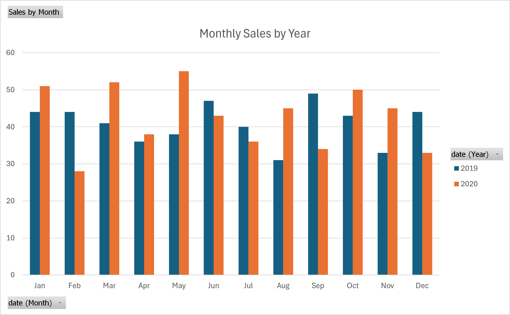
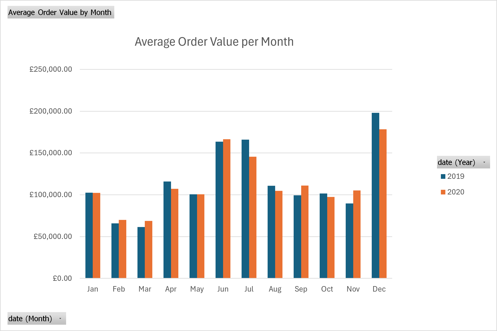
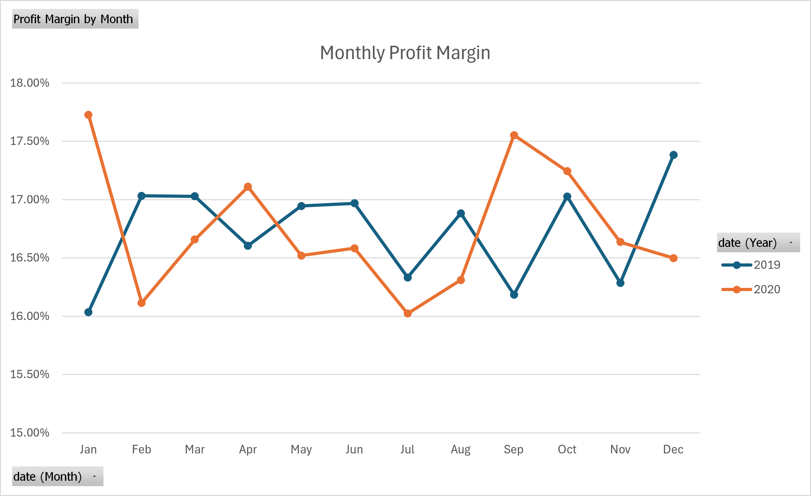
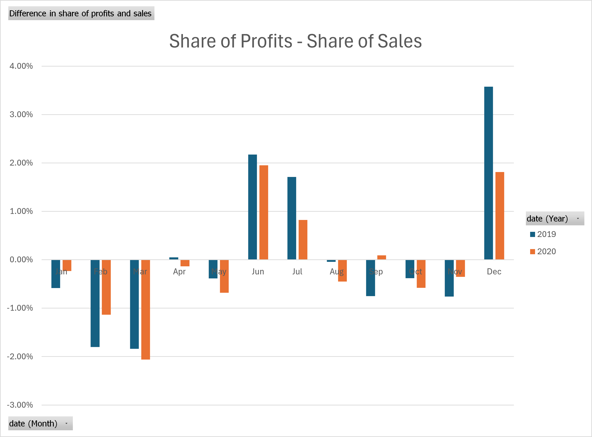
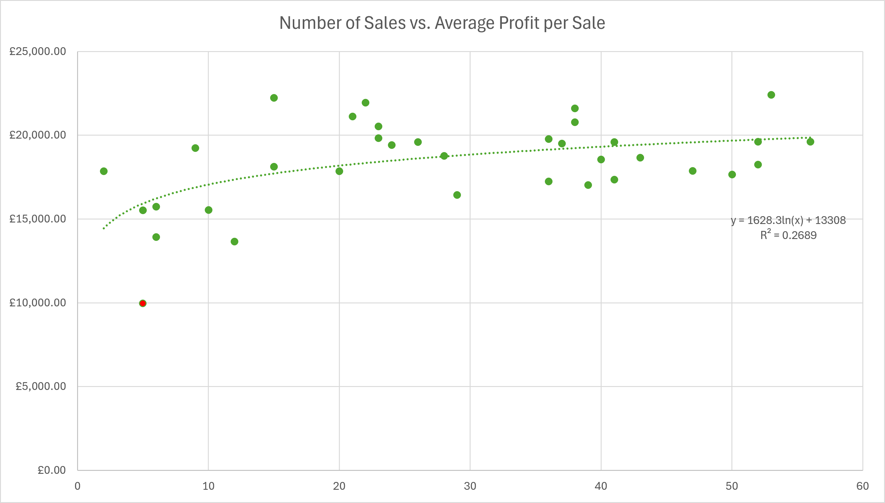

# What Drives Profit?

A business can increase profit in two ways: taking more orders, or taking bigger orders. The two call for different strategies and therefore it is important to understand what is happening here to make appropriate recommendations and areas for further investigation.

This analysis looks at two years of sales data from an online store that has 1000 orders from 75 customers which are handled by 35 sales reps across 15 countries. I looked at it by month and by sales rep. Product category was also looked at but there was no significant findings that warrant further investigation or analysis.

## Findings

- **Bigger orders drive profit** Every order earns a profit margin of between 12% and 21%, and monthly profit margin stays between 16.0% and 17.7%, so profit is a steady ~17% of revenue. What moves revenue is order size rather than total orders. Average order value more than triples from the weakest month (£61.5k, March 2019) to the strongest (£198k, December 2019), while monthly order counts stay between 28 and 55. Across the 24 months, profit correlates with the average order value at 0.88 and with order count at 0.37. But, the correlation value can only assess linear relationships so this should not be taken as a definitive marker that states the strength of the relationship by itself.
- **The strongest months are large-order months.** June and December are the two most profitable months in both years. December 2019 earned 8.0% of the two-year profit from 4.4% of the orders. December 2020 had only 33 orders, among the four quietest months, yet was still the second most profitable month of 2020.
- **Reps with very few orders earn less per order; beyond that, the data cannot tell reps apart.** Average profit per order ranges from £9,952 to £22,405, and the six lowest averages all belong to reps with 12 or fewer orders. Among the 29 reps with 10 or more orders there is almost no link between order count and profit per order, and only one of all 35 reps falls outside a two-standard-error band, roughly what chance alone would produce and it reinforces the point that there is pretty much no link between order count and profit per order.

## Order count vs order size

  
  

Order counts (left) move within a narrow band, and the two years do not follow the same pattern. Average order value (right) peaks in June, July and December and dips in February and March in both years. Monthly profit follows the right-hand chart, not the left.

  

Margin barely moves (the axis starts at 15%). Because it is close to constant, profit per order is essentially a fixed share of order value, so the real question is what drives order value.

## Strong and weak months

  

Each bar is a month's share of total profit minus its share of total orders. A bar above zero means the month earned more than its order count share and below zero means that month earned less than its order count share. June, July and December sit well above zero in both years, and February and March sit below and these are the same months that lead and trail on average order value.

A handful of very large orders makes much of the difference. All five of the largest orders in the dataset (£313k–£384k) were placed in December, four of them in December 2019, which could be a reason for these months being largely profitable relative to the other months. Can see for December if the top 8 largest orders are removed (all over £300k) the average profit per order drops 10% and the average order value drops around 5% which is significant and shows these to be largely responsible for the values we see.

## Sales reps

  

Each point is a sales rep. The spread is widest where reps have handled few orders, and narrows as order counts rise, simply because reps with a very small number of orders is a lot less reliable and is more likely to be noisy.

Reps with very few orders tend to have lower averages (r = 0.44 across all 35), but among the 29 reps with ten or more orders the link almost disappears (r = 0.16), so the pattern rests on about six reps. Five of the six reps with fewer than 10 orders sit below the overall average. Their averages are low because their orders are small. The 3 lowest-averaging reps had 10 small orders out of 23, against 8 out of 90 for the 3 highest. This could mean newer or part-time reps are given smaller orders, but the data holds nothing to relibly check that.

Beyond those reps, the differences are within what randomness would produce. Across all reps, differences in profit per order are almost entirely differences in order size (r = 0.96), and the data does not show whether reps win larger orders or are given larger customers.

## Method

- **Cleaning.** Power Query ([`let.pq`](let.pq)) loads the CSV and sets data types. The source had no missing or invalid values. A profit column (order value minus cost) is added to the table.
- **Strong and weak months.** A month is strong if its profit is more than one standard deviation above that year's monthly mean, and weak if more than one below. The data has no targets, so months are judged against each other.
- **Order size.** Orders are classed as small, average or large with the same one-standard-deviation rule on order value: small is under €51.6k, large over €175.1k.
- **Sales reps.** Reps are judged on average profit per order rather than totals, since their order counts range from 2 to 56. Each rep's average is compared with a band of two standard errors either side of the overall mean, so reps with few orders are not over-read.

## Limitations

- Two years and 1,000 orders. Monthly results rest on 24 data points, and six reps have fewer than ten orders.
- No targets, prices, product detail or rep information such as experience, territory or accounts. The data shows that order size drives profit, but not why some months or reps get bigger orders.
- Correlations show association, not cause, and assume a linear relationship.

## What I would look at next

- Whether the large orders come from a few repeat customers, and which reps hold those accounts.
- Monthly targets, to judge months against plan rather than against each other.
- Product prices, to tell whether a bigger order means more items or more expensive ones.

## Data and files

The data is the [Online Store Sales Data](https://www.kaggle.com/datasets/ronnykym/online-store-sales-data) set from Kaggle.

- [`DAProject.xlsx`](DAProject.xlsx): the workbook, with the cleaned data, a summary sheet, the monthly analysis and the sales rep analysis. The final sheet, AI Dash, is a dashboard built with Claude from my analysis, using formulae so every figure can be checked and audited.
- [`let.pq`](let.pq): the Power Query M code.
- [`Tools And Skills Used.md`](Tools%20And%20Skills%20Used.md): the Excel techniques used, with example formulae.
