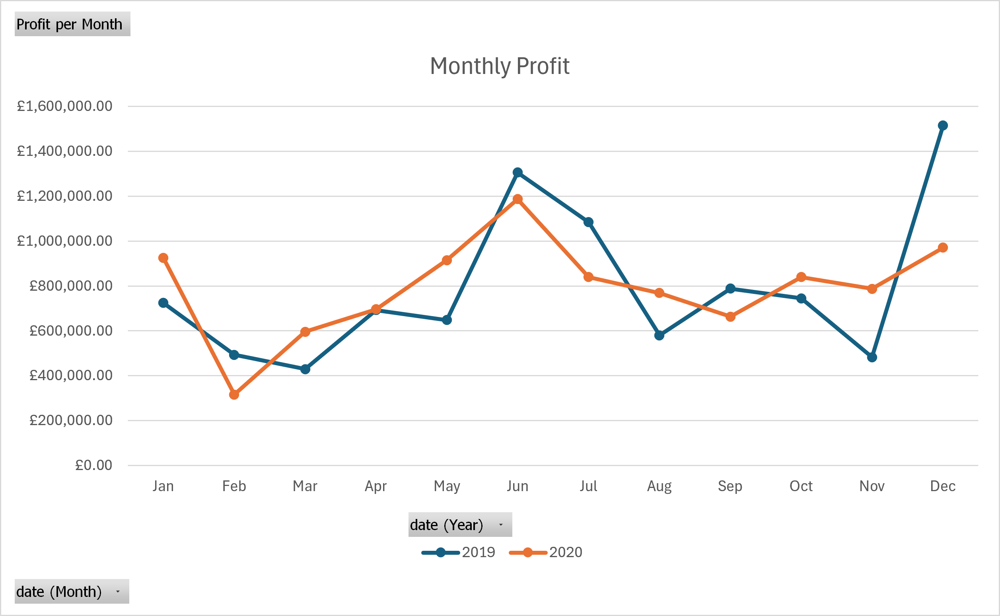
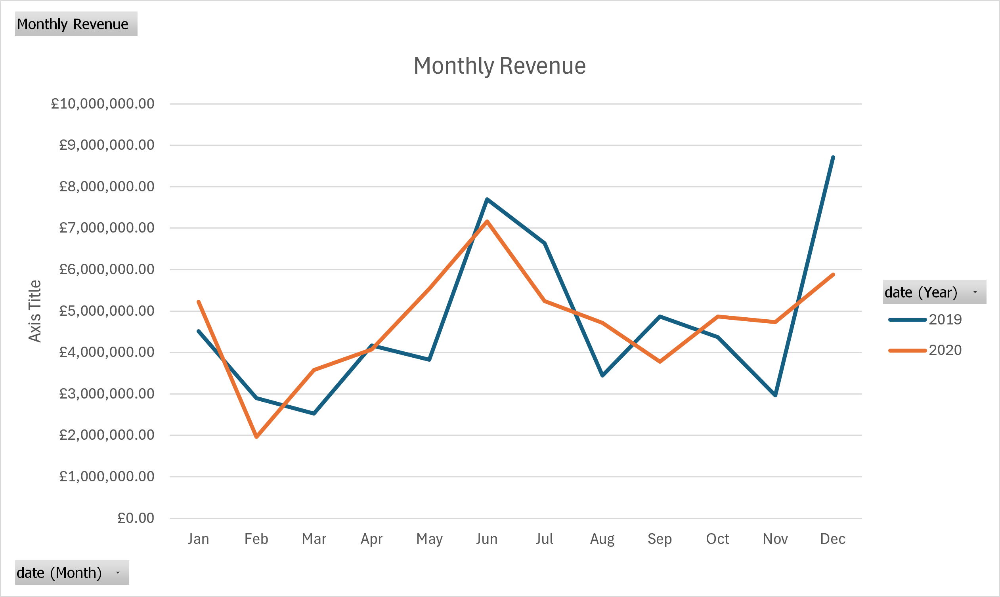
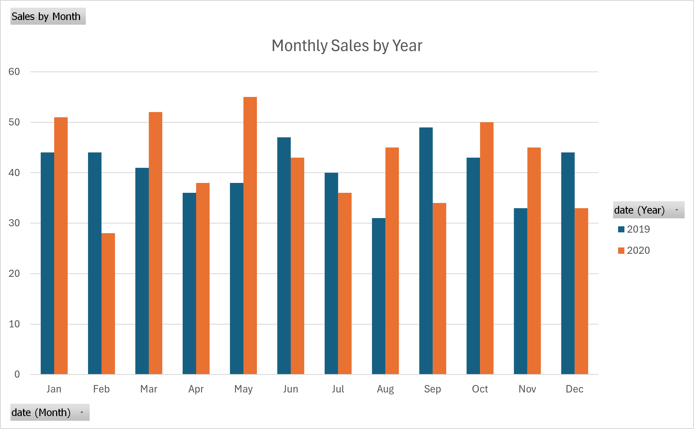
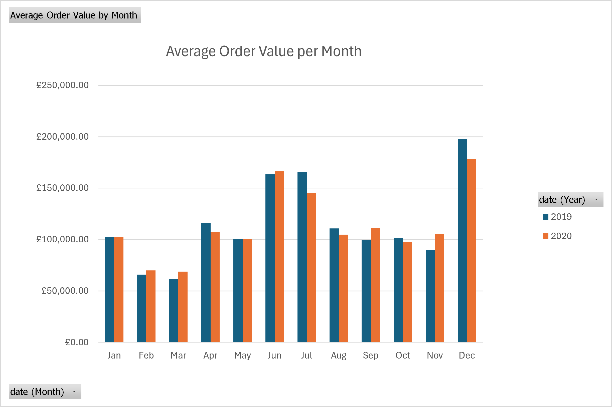
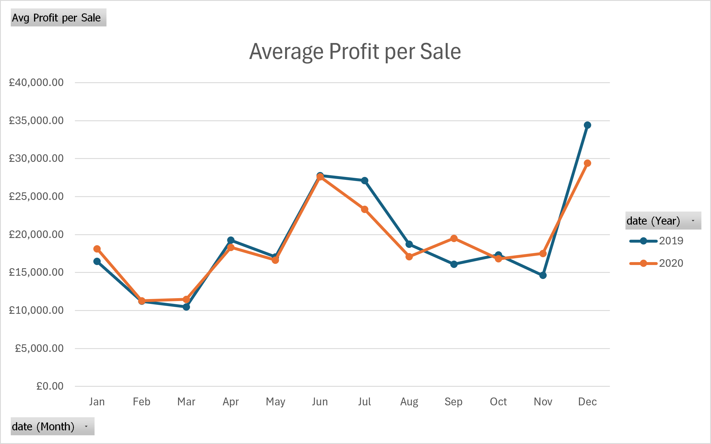
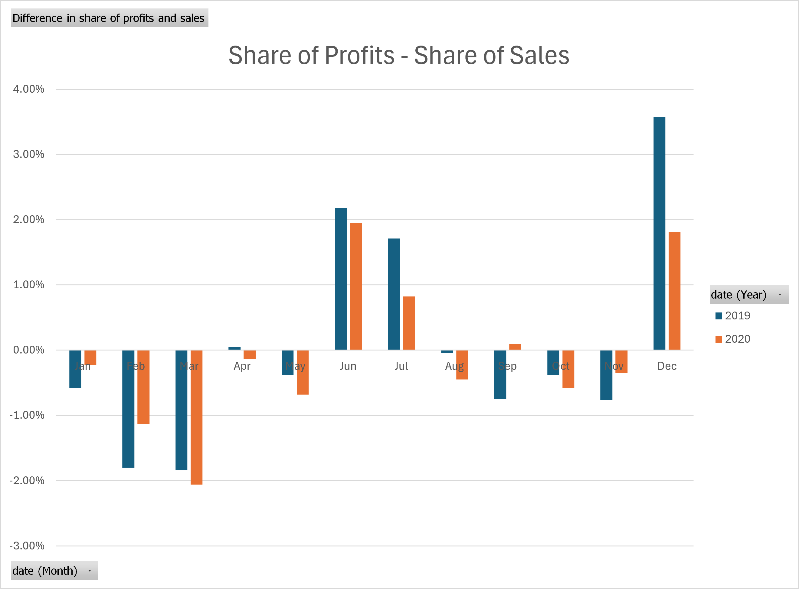
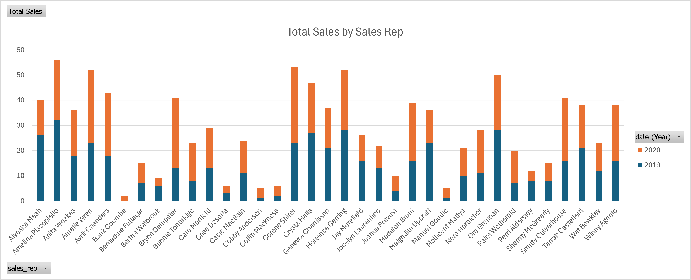
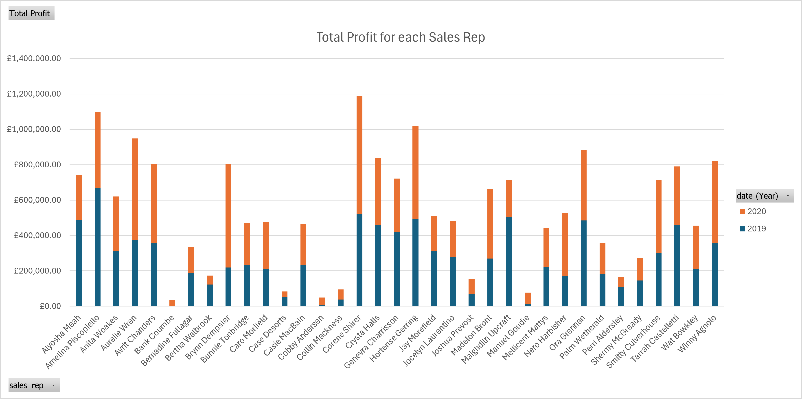
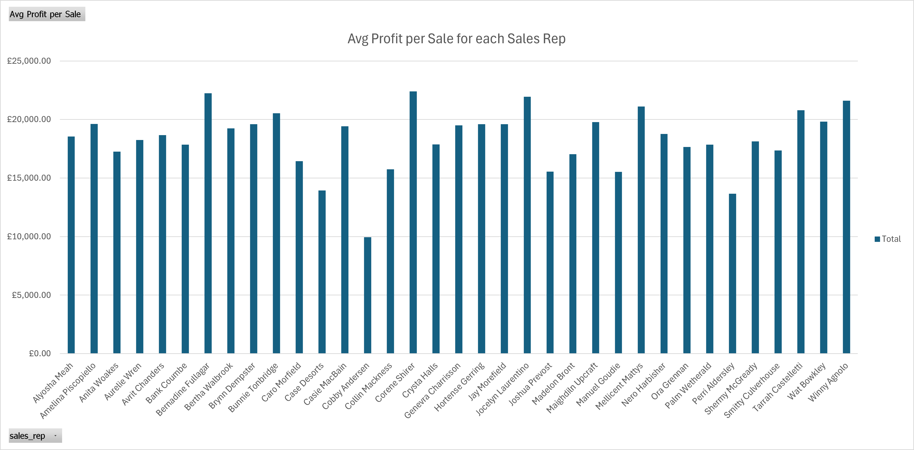

# Sales-Analysis-Project
An analysis in Excel of a sales dataset pulled from Kaggle. The aim of this is to derive key insights that can lead to and influence business decisions through data and visualisations.

# Data Source
The data is publicly available on Kaggle, found using the following link: https://www.kaggle.com/datasets/ronnykym/online-store-sales-data

# Project Aims
The overall aim is to find insights that will allow for management to make better decisions and hopefully improve future performance. Doing this requires a direction of course and requires business questions to be answered.
The first aim is to **assess whether more sales drives profit**, the second project aim is to **determine whether stronger months are driven predominantly by order volume or order size** and the final aim is to **examine performance across sales reps and uncover why some over- and under-perform**.

# Method
Before doing anything in Excel the data was processed and loaded through Power Query. There was not a lot to do here as the source data was quite clean and there were no missing values, incorrect data points or major issues. I added a profit column which was defined as order value - cost and changed a few column's data types but there was nothing 'intensive' required to be done. All of the M code is defined in the .pq file in this repository. Power Query was used rather than more 'manual' data cleaning methods directly in Excel because Power Query offers a low-code and repeatable methodology to cleaning and loading data into Excel. This query can be used however many times and when this company produces future sales data this query can be applied quickly and if there are any errors it is easy to edit the query to account for these.
Once Power Query was finished and the data was loaded into Excel as I had already inspected all of the data I could go straight into analysis. Firstly, I produced a summary sheet that analysed key metrics across the data to get a better feel for the data. These were simple metrics such as average order value, profit per order, total profit, total revenue, total costs, number of orders, number of unique customers, customer with the most orders, etc. This was to get a better insight into what the data actually looked like quickly and allow for comparisons later on. 
After summarising the data I began the actual analysis to start answering the business questions present in the order that they are presented in.

## Do more sales mean larger profits?
What this question is really asking is that per unit, does profit increase as the number of sales increases? We can see clearly that overall profit rises as overall revenue rises from the charts below.

  
  

Unsurprisingly, it is very clear that as total revenue rises for each month so does total profits. Now, if we look at the total sales for each month for 2019 and 2020 we can see if the number of sales effects tota profits.

  

So assessing this by itself, we can see that total monthly sales do not vary greatly. Looking at monthly totals across both years the range of total sales is 23, the average is 83 and the standard deviation is 8 sales so not much spread overall. For 2019 the range is 18, average is 41 and the standard deviation is 5 sales then for 2020 the range is 27, average is 42 and standard deviation is 8 sales also so monthly differences are larger in 2020 but across all of the data it is quite 'compact'. Looking at the chart now as well these statistics are clearly reflected: bars in each year look quite similar in size and there are no real outliers. When we overlay this with the monthly profit chart and the monthly revenue chart we can see that there is a clear difference in shape. Revenue and profits clearly spike in June and December but looking at sales in these months they can be interpreted as 'normal' months. There is more of a relationship with lows in the monthly profit chart and sales as months with the lowest number of sales but still not a clear, strong relationship. The correlation value between monthly sales and monthly profit overall is quite weak at 0.14 (correlation for the month and total sales in that month rather than year-month, eg January across both years rather than January-2019 and January-2020 separately) but for the individual years the correlation is somewhat strong at 0.45 for 2019 and 0.37 for 2020. This of course assumes a linear relationship so this is not entirely representative of the relationship but it gives a potential insight. So the idea that total sales drives profits is slightly weakened here.

What I think to look at next that could provide key insights is the average profit per order as well as the average order size so we completely isolate the number of sales and see if there is any relationship on a per-sale basis between profit and order value. We have already established total profit and revenue are heavily linked but this was expected.

  
  

These 2 charts are very revealing. There is a very clear relationship between average profit per sale and average order value. The 2 charts have essentially the exact same shape with lows and highs in the exact same places and even deviations like in July where the average order value drops by 12.3% and the average profit per sale drops by 14%. Months with the largest average order values have the largest profit per sale and months with the lowest order value have the lowest average profit per sale. Calculating the correlation between the average order value and profit per sale across each year there is an almost perfect correlation with a value of 0.997 in 2019 ad 0.995 in 2020 but again, this assumes a linear correlation between the 2 variables which may not be the case but from initial observations the average order value is very clearly one of the main drivers of larger profit. 
2 separate plots were used here rather than a single plot as I believe it to be clearer than trying to overlay both plots oto one another.

Now we have to look at the distribution of category sales across the 2 years as if more higher-profit category products are sold in one month this may be why certain months are more/less profitable than others. Looking at the least profitable months in 2019 first, starting with February. The product categories that are the least profitable by quite a large margin (over £1400 less profit then the next best category roughly 8% difference) are Electronics and Games. We can see from figure 5 that February is one of the lowest profit months per sale and this is likely due to the fact that over a third of all sales in 2019 are either Electronics or Games products. They represent 20% of the available product categories and they represent a disproportionate amount of the total sales in February. It is unclear whether the lower profitability per sale is due to overall performance by all sales reps in certain categories, whether there were more hidden fees or if products in these categories are just more difficult to sell so sales reps have to compromise more. Looking at the most profitable months in 2019 (December and June) their total sales are less than 10% in the most profitable categories (Accessories and Other) and for June less than 5% of sales are in the most profitable categories. The least most profitable categories makeup around 20% for both of these months also. So it is mot overly clear why December and June are as profitable as they are per sale given the category breakdown.
Order value naturally would be an intriguing point to look at but for the categories I do not think it is a safe road to go down due to the low sample size. There are vast differences month-to-month in average order value for every product category and this could be due to several reasons that are unable to be accurately determined, such as price fluctuations (no price data), customer demand (can be inferred but they may have chosen other competitors for other reasons) or the specific product within the product category varying. This data is not captured and so deeper investigation along these lines would be extremely insightful but a lot of guess work would have to be done here. One possibility that can be computed is the distribution of customers that are placing the orders. Some customers may place larger orders in certain categories or in certain months and this may uncover the reasons for larger order values and profits. But, to confidently say that a customer's order size is regularly x in this category is not what can be done for most customers again due to the small sample size. There are several customers though with larger sample sizes hat can be analysed in-depth.
Looking at customers overall, there are 75 unique customers with an average order size of £113,361.74 across both years and a standard deviation of £22,870.30 which is just over 20% of the average - quite a large spread. The range of average order values £135,828.94 which is quite large and is a potential sign that profitability is largely dependent on the customer (as we established the strong relationship between average order value and average profit). Without going into categories we can see different correlation values below which reveal another insight.

| | Orders and Average Order Value | Orders and Average Profit | Average Order Value and Average Profit |
|---|---|---|---|
| **Overall Customers** | 0.0344 | 0.0190 | 0.9578 |
| **Customers with > 20 orders** | 0.3663 | 0.4595 | 0.9370 |

The relationship between orders and average order value plus orders and average profit appears to get much stronger when the number of orders are over 20 for each customer. There are only 10 of these customers though and 20 was chosen as it equates to roughly 1 order a month across the 2 years and if I chose 24 then only 3 data points would have been present and the value likely would have been very noisy. The discovery hear is not a confirmation but it is an interesting point of investigation in the future to monitor profitability as this is the first and quite a strong sign of order total driving profitability. This is excluding all other variables though, hence why it is an area of future investigation rather than a confirmed relationship. These correlation values assume a linear underlying relationship as well as this correlation can only be meaningfully calculated if the relationship is linear. (maybe try measure non-linearity)
### Conclusion

What the data tells us is that it is quite unlikely that more profits equates to more profits. From what we have seen the factor that potentially drives larger profits the most is the order value. The data is quite restrictive in terms of what it can actually allow us to confidently conclude here due to the small sample sizes and the lack of data granularity but it does flag areas of future, deeper investigation with the right data.

## Are stronger months determined by order volume or order size?

Firstly, we need to determine what a 'stronger' and a 'weaker' month actually are as this is completely arbitrary. I will compare each month to one another rather than an arbitrary baseline number and use profitability as the metric to gauge strength. For this I will define 3 categories: average, above average and below average. Categories boundaries are defined using the following formulae:
Average = $\mu$, Above/Below Average: = $\mu \pm \sigma$.
These will be different for each year. We will look at above and below average months only. In 2019 June and December are above average with March being below average then in 2020 June is above average and February is below average. If we refer back to figure 4 and 5 if we look at 2019 first we can see that the lowest profit per sale month was March and the highest were June and December. In 2020 the lowest month was February and the largest month was actually December with June close behind. These charts are strong evidence for profit per sale to be a main indicator of performance but it is not the only one, hence the discrepancy between best performing months in 2020. Number of sales therefore does play a smaller role in determining strength as in 2020 June's total sales exceeded December's by just over 30% which tipped June into the 'Above Average' category.

  

This chart above shows the difference between the share of profits and share of sales across all 24 months. So if month X accounted for 5% of overall sales and 4% of profits this would be 4-5 = -1 percentage point. What I have regarded as a strong month in this context is if this metric is > 0 due to the fact that for these months the sales disproportionately accounted for a portion of the profits. In theory if everything was equal, 5% of sales should represent 5% of profits but as the visual above shows this not the case. In December 2019 we can see that profits make up 3.58 percentage points more than the sales make up overall. This is the largest difference out of any month. Then in June 2019, June 2020, July 2019 and December 2020 we see an over 1 percentage point larger representation of profits than sales. If we look at all of these specific months in figures 4 and 5 we can see the same months have the largest order values and profits per sale. Then looking at figure 3 we can see the relative sales totals of each of these months and their is no clear relationship between figure 3 and 6 like there is with 4+5 and 6. So this is a strong indication that strong months are driven largely by profits per sale and the average order size.

Product category sales across each month will also affect monthly performance as if more products from a more profitable category are sold then this will of course be a key reason for better performance. Some categories have very few orders or none at all in several months so the months with very few are likely to produce some noisy results. Of course overall the averages for each month will be the same as if we looked at monthly average through any other lens but the key is to see if any poor or good months are mainly driven by one or very few categories. Assessing each month across all categories for both years there appears to be no pattern at all in terms of average order size, number of orders and the product category. Accessories in January 2019 had a single order of around £36,750 and then in January 2020 had a single order of £107,700. In some categories the average order value for the same month across both years dropped by nearly 40% when the number of orders increased by 400% then other categories have an increase of over 100% in average order value across the same month for the 2 years with the number of sales rising by 400%. These are a few examples but across all month, year and category combinations there appears to be no clear relationship at all and the most likely driver of average order value rising is the customer placing the order. They may need more or less at different times and there are 75 distinct customers all with different needs and requirements.

Specific customers may be dictating how certain months perform by placing larger orders in certain months. As stated before the average order size is £113,361.74 and looking at the breakdown of customer orders by month and looking at the average order value of those months we see several extremely large orders placed. For example, Kihn Ic placed an order worth over £300,000 in December 2020, McGlynn-Prosacco placed an order in July 2019 of over £250,000 and Schmitt, Purdy and Johnson placed 2 orders over £250,000 in 2020. these are only a few examples but these all represent orders largely over the average order value and if concentrated can really 'enhance' a month's performance. This is definitely a flag for further investigation. Determination of the reasons why orders were so large in certain year-month combinations is not possible from the data available to us here unfortunately but would easily be possible with more granular data.

### Conclusion

To conclude here I think it is fair to say that stronger months are driven by order size much more than order volume but the customer placing the orders is also a potential factor in monthly performance. Each specific customer will have varying needs and requirements at different times which is most likely what causes the apparent randomness of average order value. The price of the specific products also would affect this but this level of data is unavailable here. 

# How Sales Reps Perform: Why some over- and under-perform
There are 35 distinct sales reps which are spread across 15 different managers and 15 different regions. Sales reps do not appear to be responsible for specific sectors or product categories alone but some are solely responsible for a region/country due to the fact that they are the only one assigned to a specific manager and each manager accounts for a single country. A sales rep's performance will be judged using aggregated values rather than total values due to the fact that we do not know why the number of sales varies so much for the reps and as there is a multitude of possible reasons this could be this will not be included here. The main assessment will be average profit per sale as for the business this is the best determinant of success and ability of a sales rep rather than revenue. 

  

The number of sales reps varies greatly as figure 7 shows with some reps having less than 10 sales and others exceeding 50, hence why we are looking at aggregate figures to properly assess performance as stated above. The individuals with lower total sales can stil be assessed but it will not be a true reflection without more granular data.

  

Figure 8 mirrors the shape in figure 7 and highlights the already-established relationship between number of sales and the total profit. What needs to be looked at is the average profit per sales rep.

  

Figure 9 shows the average profit for every sales rep, including those with very few sales. What we can see is the number of sales does matter to a degree in determining the average profit per sale but the plot looks noisy. The correlation value between the average profit and the number of sales for each sales rep produces a value of 0.44 (rounded) which shows a somewhat strong positive correlation between the 2 variables. But looking at the chart this does not appear to be the case immediately. For the larger average profit values, which I will say are over £20,000, there are 7 sales reps and they have 15, 23, 53, 22, 21, 38 and 38 sales respectively. Looking at these values and comparing to the average sales per rep of 28 there does not really appear to be a pattern here. Assessing sales reps with lesser average profit values, defined as under £15,000 here, there are 3 sales reps that have 6, 5 and 12 sales respectively. This is likely where there is 'more' correlation as these values are quite far below average sales and the average profit for each of these sales reps is low. So from this we can state that at lower number of total sales by reps it is likely that there is a stronger relationship between the average profit made, but the reasons for this are currently unknown but will be looked at by assessing these sales reps individually. 
Using the data present it is possible to establish an equation to predict future sales rep performance. 

  

There are a few interesting points to note. Firstly, I chose a logarithmic relationship due to the fact that it fit the data points far better than a linear relationship did and the specific reason for this is the data point highlighted in red. I highlighted this as it could be interpreted as an outlier as it is quite far from every other point in the plot and is roughly 35% below the next lowest point. Exclusion of this is invalid though due to the fact that there is insufficient evidence of error or reason to remove this point. The equation of the line is not overly important but the $R^{2}$ value is. This is 0.269 and essentially states that roughly 27% of the observed variation is able to be explained by the equation of the line, showing it to be a poor fit overall but surprisingly this is the best. A linear fit has a value of less than 0.2 and every other fit is far worse than this. The main conclusion to be drawn from this plot is that the relationship between the number of sales and the average profit per sale overall is quite weak but at lower number of sales it is slightly stronger. Just a note on this graph: the relationship shown does not represent something with the ability to predict future performance as it has not been tested on unseen data so it is more of an observation rather than something with predictive ability.

### Individual Sales Reps

Here it will be examined if there are any common traits between the 'best' and 'worst' performing sales reps using the definition of success defined above. Firstly, the 3 worst performing sales reps achieved an average profit per sale of  £9952.41, £13,931.78 and £13,659.87 respectively. They all had a far below average number of sales just to note. Looking at the categories they made sales in all 3 of them had their average profit per sale far lower than the large majority of sales reps. This is likely due to the smaller order size these sales reps handled. Looking at the raw data and assessing their order size classification there is a single large order and 43.5% of their combined orders classed as small orders. This is very likely the main reason for their poor performance as then if we assess the top 3 performing sales reps who have an average profit per sale of £22,229.62, £22,405.31 and £21,934.84 they have very few small order sizes and just under 8% of their combined sales were classed as small, many of their average orders are on the upper side of the average bound and large orders account for nearly 20% of their sales/orders. Due to the relationships we have established beforehand it is clear that the most likely indicator of performance is the size of the order that a sales rep handles. Looking at individual categories appears to be noisy and is determined by the order size rather than the product category.

### Conclusion
The investigation of sales reps appears to come down to the size of the order that they handle and on average the order size more than anything. The number of sales handled is also important here as a few sales may have been abnormally large/small which increased/decreased individual's totals and this is evident with the poorer performing reps whereby they have very few sales relative to most other reps and a large percentage of them are significantly below average order value. This is a flag for investigation rather than a proper conclusion though, as the data here is insufficient to truly determine a rep's ability to sell. Data such as the targets, responsibilities and experience would be much more informative and reps with more sales as judging one's performance using 5 sales across 24 months is extremely unlikely to be a true reflection of their ability, unless the industry is infrequent in sales but this is undeterminable accurately here.

# Assumptions
For determining the strength of months there were no targets present within the dataset so I had to assume what would define a stronger and weaker months using data, making each month's performance relative to one another rather than relative to monthly targets. This slightly weakens the analysis as in reality targets for each month would be set that usually differ month-to-month based on varying goals and needs of the business.

Nothing stated this explicitly but for all sales I assumed that they were all independent of one another. I do not think this assumption would have affected the analysis too negatively but in reality this is unlikely the case, especially when sales reps have targets to meet and would react to their totals and change their approach.

Sales reps work independently of one another. This did not really affect this analysis but could affect later analysis. This likely is not entirely realistic as some sales managers have several sales reps and they may change them around depending on their performances or reassign them and so on. 

# Limitations
The dataset is not overly detailed and is quite simplistic so the granularity of analysis is not the finest due to this and inferring data is low-quality and poor practice so I tried to derive the insights that I could to get to the bottom of each business question. Things like sales targets would have helped greatly and more data as well. Establishing relationships using data where there are not many data points is difficult as it is very difficult to tell if it is noise that is on-show or if there is a genuine relationship and there is just less data. Thsi is especially the case when looking at sales by category for each sales rep.
